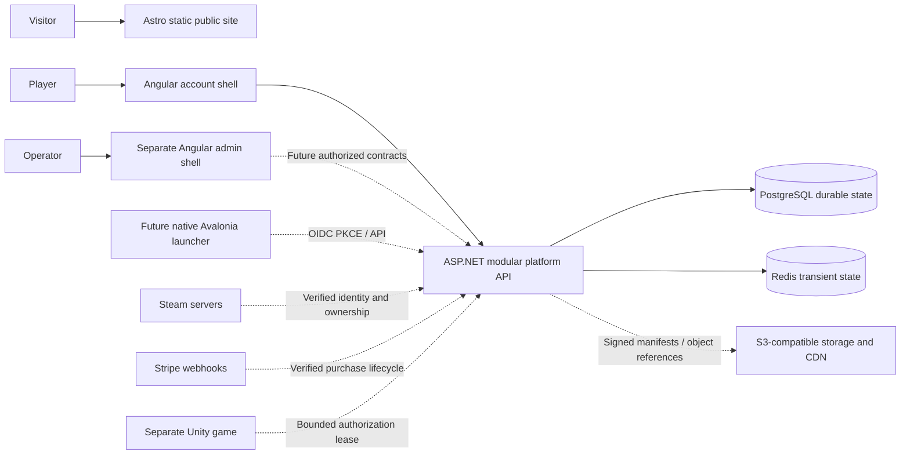

# Platform overview

Caelora is a native Unity 6/C# Windows game. World generation, voxel simulation, local saves, input, combat and eventual authoritative game servers remain in game repositories. Web applications do not participate in core simulation.

This repository is the surrounding platform: public discovery, future commerce, identity, entitlement queries, launcher distribution, optional backups and server discovery. Its first milestone implements the static site, honest public shells, a small operational API and reproducible development boundaries.

Dashed connections are architecture for later milestones, not current integrations. The only application API today is GET `/api/v1/platform`. PostgreSQL/Redis readiness integrations are real and opt-in locally; both are mandatory outside Development/Testing.

## Backend boundary and evolution

Use a modular monolith with one deployment, dependency injection and separately owned feature areas. Current folders distinguish Contracts, Application, Configuration and Infrastructure. There is no speculative Domain layer with empty account/payment entities. Add domain entities and invariant tests when implementing an actual feature; application code owns use cases, infrastructure owns EF/provider operations, HTTP owns transport. Do not make domain rules depend on controllers, Angular or Unity types.

Planned modules: Identity, Entitlements, Commerce, LauncherDistribution, SecurityActivity and later Community/ServerDiscovery/Backups. Entitlements owns the final ownership decision even when input arrives from Steam or Stripe. A browser capability flag never proves ownership. PostgreSQL is the durable authority; Redis is replaceable transient coordination, not a second entitlement ledger.

## Delivery and scale

Astro builds static content to a CDN. Angular applications build independently; runtime JSON config can vary without rebundling JavaScript. The API runs as a non-root container behind a TLS ingress. Start with one API instance and managed PostgreSQL/Redis. Introduce a durable outbox and a background worker when payments/email need reliable delivery. Do not add Kafka, microservices or Kubernetes for this milestone.

Scale independent bottlenecks when measured. Redis gameplay leases need fencing and a durable policy revision; they must not turn a Redis outage into permanent loss of ownership. World backups require quotas, encryption, retention, object integrity and safe deletion before enabling uploads. Game-server simulation authority is separate from platform account and purchase authority.
